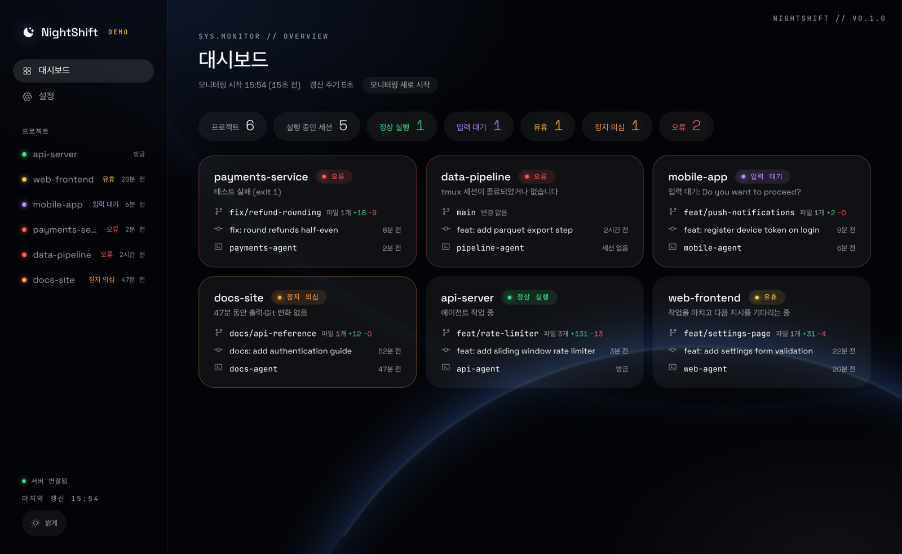
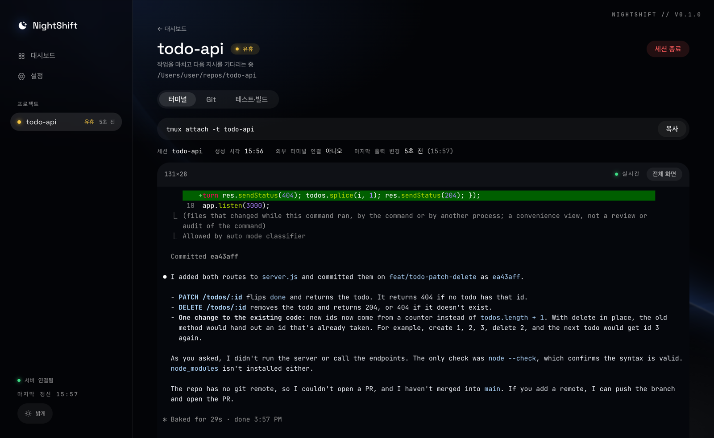
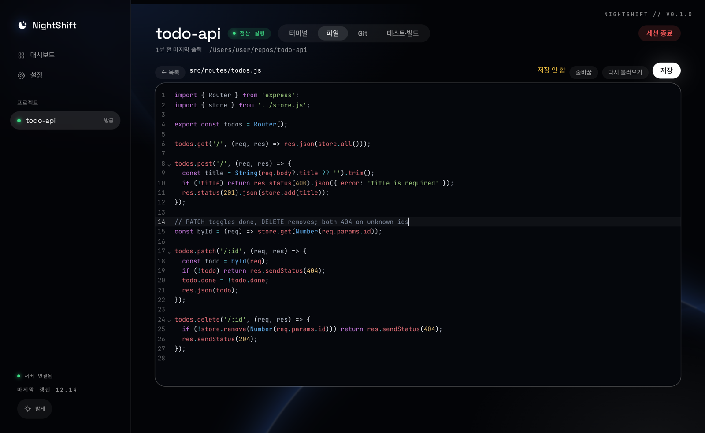
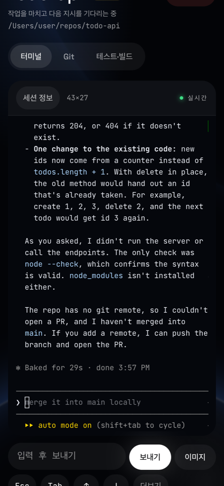
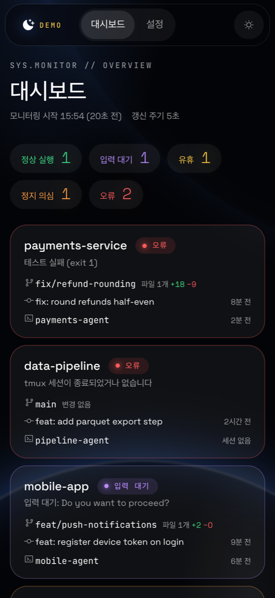

<div align="center">

# 🌙 NightShift

**휴대폰에서 Claude Code·Codex 세션을 보고 조종하는 원격 개발 대시보드**

tmux에서 도는 AI 코딩 에이전트를 실시간 터미널로 보고, 키를 치고, 끝나거나 입력을 기다리면 푸시로 알려 줍니다.
서버는 내 컴퓨터에서만 돌고, 밖에서는 Tailscale로 접속합니다.

[](https://github.com/WhiteJbb/nightshift/actions/workflows/ci.yml)
[](LICENSE)


*A self-hosted dashboard to watch and drive Claude Code / Codex tmux sessions from your phone. Real xterm.js terminal over tmux control mode, busy/idle/waiting detection, one-tap answers to agent prompts, and push notifications via ntfy. Runs on macOS, Linux (including Raspberry Pi) or WSL2, reachable over Tailscale.*

</div>

<p align="center">
  
</p>

<p align="center">
  
</p>

<p align="center">
  
</p>

<p align="center">
  
  &nbsp;&nbsp;
  
</p>

## 왜 만들었나

AI 에이전트에게 긴 작업을 맡겨 두면, 정작 사람이 할 일은 "다 됐나?", "뭘 물어보고 멈춰 있나?"를 확인하는 것입니다. 그때마다 컴퓨터 앞으로 돌아가야 했습니다.
NightShift는 tmux 세션을 그대로 휴대폰 브라우저로 가져옵니다. 침대에서, 이동 중에 에이전트가 무엇을 하는지 보고, 승인 질문에 버튼 하나로 답하고, 다음 지시를 보냅니다.

## 주요 기능

- **실시간 터미널**: tmux 컨트롤 모드로 pane을 xterm.js에 그대로 그립니다. 컴퓨터에서는 네이티브 터미널처럼 모든 키·복사·우클릭 붙여넣기·전체 화면, 휴대폰에서는 화면 폭에 맞춘 글꼴, 빠른 터치 스크롤, Esc·Tab·화살표 버튼, 글자 골라 복사, 이미지 붙여넣기
- **상태 판정**: 정상 실행 / 입력 대기 / 유휴 / 정지 의심 / 오류. 에이전트 세션은 화면 아래의 작업 중 표시(`esc to interrupt`)로 판단해, 화면이 다시 그려지는 것만으로 "실행 중"이 되지 않습니다
- **찾기 쉬운 순서**: 오류·입력 대기·정지 의심을 맨 위에, 그다음 작업 중인 세션, 그다음 최근에 일한 순서(에이전트가 마지막으로 작업 중이던 때나 Git이 마지막으로 바뀐 때, 스크롤해 보기만 한 것은 치지 않음)로 놓습니다. 방금 일을 마친 세션이 작업 중인 세션 바로 아래에 옵니다
- **바로 답하기**: 에이전트가 번호 선택지 프롬프트를 띄우면 카드와 터미널에 버튼으로 나옵니다
- **휴대폰 푸시** ([ntfy](https://ntfy.sh)): 입력 대기·정지 의심·오류, 그리고 **작업 끝남**. 보고 있는 동안은 보류하고, 끝났다가 금방 다시 일하면 보내지 않아 알림이 시끄럽지 않습니다
- **세션 관리**: 대시보드에서 세션 이름과 에이전트만 고르면 바로 띄우기. Git 주소를 주면 `~/repos/`에 clone까지
- **Git·테스트**: 카드마다 브랜치·변경 파일·최근 커밋, 등록한 테스트·빌드 명령을 버튼으로 실행
- **파일 보기·고치기**: 저장소 파일을 바뀐 파일부터 트리로 찾아 열고, 문법 색이 들어간 편집기로 고쳐 저장. Markdown 미리보기, 에이전트가 먼저 고친 파일은 덮어쓰지 않고 알림
- **로컬 우선**: 외부 DB·API 키 없음. 서버는 기본으로 `127.0.0.1`에만 바인딩, 원격 접속은 Tailscale(HTTPS)로만

## 구조

```
휴대폰·노트북 브라우저
   │  HTTPS (Tailscale) · SSE로 상태 스냅샷과 터미널 스트림
   ▼
NightShift 서버 (Node · Express)
   │  tmux -C (컨트롤 모드) · git · ps
   ▼
tmux 세션 ── Claude Code / Codex
```

TypeScript · React · Vite · Express · xterm.js. 자세한 설계는 [ARCHITECTURE.md](ARCHITECTURE.md).

## 요구 사항

- macOS, Linux(Ubuntu·Debian·라즈베리파이, [Linux에서](#linux에서-ubuntu-라즈베리파이)), 또는 Windows의 WSL2 ([Windows에서 (WSL2)](#windows에서-wsl2))
- Node.js **22.18 이상** (서버를 TypeScript 그대로 실행합니다)
- `git`, `tmux` (없으면 setup이 설치합니다. demo mode에는 필요 없음)
- 지켜볼 에이전트: [Claude Code](https://docs.claude.com/en/docs/claude-code) 또는 [Codex](https://github.com/openai/codex) (셸만 띄워도 됩니다)
- 휴대폰에서 보려면 [Tailscale](https://tailscale.com/download) (개인 무료): 이 컴퓨터와 휴대폰에 깔고 같은 계정으로 로그인

## 빠른 시작

```bash
git clone https://github.com/WhiteJbb/nightshift.git nightshift
cd nightshift
npm run setup
```

`npm run setup` 하나로 끝납니다.

- Node 버전을 확인하고, 의존성을 설치하고, 빌드합니다. git·tmux가 없으면 설치합니다(Homebrew, Linux는 apt).
- Tailscale이 켜져 있으면 `tailscale serve`로 휴대폰용 https 주소를 열고 그 이름을 config의 `allowedHosts`에 적습니다. 그 기기의 443을 이미 다른 데 쓰고 있으면 건드리지 않습니다.
- 로그인하면 자동으로 뜨게 등록합니다(macOS launchd, Linux systemd 사용자 서비스). 서버가 떴는지 확인한 뒤 접속 주소와 로그·재시작·끄기 명령을 보여 줍니다.
- `nightshift` 명령을 PATH에 겁니다(`npm link`). 그다음부터는 어느 폴더에서나 아래처럼 씁니다.
- 다시 돌려도 됩니다. 업데이트는 `nightshift update`(= `git pull && npm run setup`)입니다.

```bash
nightshift status    # 돌고 있는지와 접속 주소 (이 컴퓨터·휴대폰)
nightshift open      # 브라우저로 열기
nightshift logs      # 서버 로그
nightshift restart   # 다시 띄우기
nightshift stop      # 끄기 (다음 로그인·부팅 때 다시 뜬다)
nightshift start     # 켜기
nightshift update    # git pull 뒤 setup
```

`npm link`가 전역 폴더에 쓸 권한이 없으면(Linux에서 apt로 받은 node 등) setup이 `sudo npm link`를 안내합니다. 명령이 없어도 아래의 `launchctl`·`systemctl` 명령으로 똑같이 할 수 있습니다.

자동 시작 없이 직접 띄우려면 `npm install && npm run build && npm start`.

자동 시작 등록 없이 화면만 먼저 보려면 clone한 폴더에서 `npm install && npm run demo` 뒤 <http://127.0.0.1:4477> (가짜 데이터, [Demo mode](#demo-mode)).

### 처음 쓰기

브라우저에서 <http://127.0.0.1:4477> 을 엽니다(`nightshift open`). 설정 파일은 아직 필요 없습니다.

1. 돌고 있는 tmux 세션이 **미등록** 카드로 보입니다. **등록**을 누르면 프로젝트가 되고, 그때 `config/nightshift.json`이 만들어집니다.
2. 아직 세션이 없으면 **+ tmux 세션 만들기**에서 세션 이름과 에이전트(셸만 / Claude Code / Codex)를 고릅니다. 세션을 띄워 에이전트를 시작하고 터미널 화면으로 갑니다. Git 주소를 주면 clone부터 합니다.
3. 임계값·알림은 상단 **설정**에서 바꿉니다.

### 휴대폰에서 열기

1. 휴대폰에 Tailscale 앱을 깔고 이 컴퓨터와 같은 계정으로 로그인합니다.
2. setup 마지막에 나온 https 주소(`https://<기기>.<tailnet>.ts.net`, 다시 보려면 `nightshift status`)를 휴대폰 브라우저로 엽니다. 홈 화면에 추가해 두면 바로 열 수 있습니다.
3. 할 일이 끝나거나 입력을 기다릴 때 푸시를 받으려면 설정의 **휴대폰 알림**에 ntfy 주소를 적습니다([휴대폰 알림 (ntfy)](#휴대폰-알림-ntfy)).

- setup을 돌릴 때 Tailscale이 꺼져 있었으면 켜고 로그인한 뒤 `nightshift setup`을 다시 돌리면 됩니다.
- 이 tailnet에서 처음 https를 열면 Tailscale이 HTTPS를 켜라는 링크를 보여 줍니다. 링크를 열어 허용하세요. 그 사이 setup이 실패했으면 허용한 뒤 다시 돌리면 됩니다.
- 주소는 내 tailnet의 기기에서만 열립니다. 인터넷에 공개되지 않습니다.

설정 파일을 직접 쓰고 싶으면 `cp config/nightshift.example.json config/nightshift.json` 뒤 [config 작성](#config-작성)을 보세요. 서버를 켜 둔 채 저장해도 바로 반영됩니다.

## 실행

```bash
npm run build && npm start   # 프로덕션 모드
npm run dev                  # 개발 모드 (프론트엔드 HMR 포함, 빌드 불필요)
```


| 옵션 | 설명 |
| --- | --- |
| `--config <path>` 또는 `NIGHTSHIFT_CONFIG` | config 파일 경로 (기본 `config/nightshift.json`, 없으면 `.yaml` → `.yml`) |
| `--demo` 또는 `NIGHTSHIFT_DEMO=1` | demo mode |
| `--fresh` | 저장된 모니터링 세션을 무시하고 새로 시작 |

예: `npm start -- --config ~/my-nightshift.yaml`

- config 파일이 없으면 빈 대시보드로 시작하고, 시작할 때 형식이 잘못되었으면 문제 목록을 출력하고 종료합니다.
- **config를 저장하면 1~2초 안에 자동으로 반영됩니다** (재시작 불필요). 다시 읽다 실패하면 이전 설정으로 계속 동작하고 화면 위쪽에 오류가 표시됩니다. `host`·`port`만은 재시작해야 바뀝니다.
- **모니터링 세션은 재시작해도 이어집니다.** 기준점(최초 브랜치·커밋), 실행 결과·이력이 `.nightshift/state.json`에 저장됩니다. 처음부터 다시 보려면 대시보드의 "모니터링 새로 시작" 버튼을 누르거나 `--fresh`로 실행하세요.

### 백그라운드로 실행 (macOS, 로그인하면 자동 시작)

`npm run setup`이 `~/Library/LaunchAgents/com.nightshift.plist`를 만들어 등록합니다. 서비스는 setup을 돌린 터미널의 `node`와 `PATH`를 씁니다. 그래서 node나 에이전트를 다른 곳에 새로 깔았으면 setup을 다시 돌리세요.

```bash
launchctl kickstart -k gui/$(id -u)/com.nightshift   # nightshift restart (코드를 바꿔 npm run build 한 뒤)
launchctl bootout gui/$(id -u)/com.nightshift        # nightshift stop
tail -f .nightshift/server.log                       # nightshift logs
```

launchd로 띄운 node는 터미널의 폴더 권한을 물려받지 않습니다. 다운로드·문서·데스크탑 아래 저장소를 보려면 node에 전체 디스크 접근 권한을 주세요(setup 마지막에 경로가 나옵니다, [문제 해결](#문제-해결) 참고).

서버가 죽으면 launchd가 다시 띄우고(`KeepAlive`), 모니터링 세션은 `.nightshift/state.json`에서 이어집니다. 같은 사용자로 로그인해 있는 동안만 돌고, tmux 세션도 그 사용자의 것을 봅니다.

## Linux에서 (Ubuntu, 라즈베리파이)

고칠 것 없이 그대로 돌아갑니다. 맥 데스크톱 알림만 빠지고, 휴대폰 알림(ntfy)은 그대로입니다. Ubuntu 24.04(x86_64·arm64)와 Debian bookworm arm64(라즈베리파이 OS와 같은 기반)에서 빌드·테스트·실시간 터미널까지 확인했고, 실제 라즈베리파이 기기에서도 검증했습니다.

```bash
sudo apt update && sudo apt install -y git tmux
curl -fsSL https://deb.nodesource.com/setup_22.x | sudo -E bash - && sudo apt install -y nodejs   # Node 22.18 이상
git clone https://github.com/WhiteJbb/nightshift.git ~/nightshift && cd ~/nightshift && npm run setup
```

- **Node 버전:** 배포판 apt의 `nodejs`는 너무 오래됐습니다(Ubuntu 24.04는 18). 위처럼 NodeSource나 nvm으로 22.18 이상을 까세요.
- **라즈베리파이:** 64비트 OS(arm64)가 필요하고, 라즈베리파이 4·5를 권합니다. 1세대 Pi Zero·Pi 1(armv6)용 Node 22는 없습니다. 같은 기기에서 Claude Code·Codex도 돌린다면 램 2GB 이상이 편합니다.
- **휴대폰에서 접속:** Linux 기기에 Tailscale을 깔고 로그인한 뒤 setup을 돌리면 https 주소를 엽니다. 권한 오류가 나면 `sudo tailscale set --operator=$USER`를 한 번 실행하고 `nightshift setup`을 다시 돌리세요.
- **자동 시작:** `npm run setup`이 systemd 사용자 서비스(`~/.config/systemd/user/nightshift.service`)를 등록하고, 로그아웃해도 돌도록 linger를 켭니다(권한이 없으면 `sudo loginctl enable-linger $USER`를 안내합니다). 관리 명령은 아래 WSL2의 4번과 같습니다.

## Windows에서 (WSL2)

WSL2 안은 진짜 리눅스라 tmux·git·Claude Code·Codex를 Mac과 똑같이 씁니다. NightShift도 고칠 것 없이 WSL 안에서 그대로 돌립니다(맥 데스크톱 알림만 빠지고, 휴대폰 알림 ntfy는 그대로). Windows에서 바로(WSL 없이)는 tmux가 없어 돌지 않습니다.

> 실제 Windows 기기에서는 아직 검증 전입니다. 막히는 곳이 있으면 이슈로 남겨 주세요.

**1. WSL과 도구 설치** — PowerShell(관리자)에서:

```powershell
wsl --install -d Ubuntu      # 설치 후 재부팅, Ubuntu 사용자 만들기
```

Ubuntu 터미널에서:

```bash
sudo apt update && sudo apt install -y git tmux build-essential
curl -fsSL https://deb.nodesource.com/setup_22.x | sudo -E bash - && sudo apt install -y nodejs   # Node 22.18 이상
npm install -g @anthropic-ai/claude-code @openai/codex   # 쓰는 에이전트만
git clone https://github.com/WhiteJbb/nightshift.git ~/nightshift && cd ~/nightshift && npm run setup
```

저장소는 `/mnt/c/...`(Windows 드라이브)가 아니라 WSL 안(`~/repos/...`)에 두세요. Windows 드라이브 위에서는 git이 매우 느립니다.

**2. Windows 브라우저에서 확인** — <http://127.0.0.1:4477>. setup이 자동 시작까지 했으면 이미 떠 있고, systemd가 꺼져 있어 건너뛰었으면 `npm start`로 띄웁니다. WSL2는 `127.0.0.1`을 Windows로 넘겨 줍니다.

**3. 휴대폰에서 접속 (Tailscale)** — Tailscale은 **Windows에** 설치합니다. NightShift는 기본값(`127.0.0.1`)에 그대로 두고, Windows의 PowerShell에서 중계합니다.

```powershell
tailscale serve --bg --https=443 http://127.0.0.1:4477
```

그리고 WSL 쪽 `config/nightshift.json`에 Windows 기기의 이름을 적습니다(`tailscale status`로 확인).

```json
{ "allowedHosts": ["my-pc.tailnet-name.ts.net"] }
```

중계가 WSL까지 닿지 않으면 Windows 11에서는 `%UserProfile%\.wslconfig`에 아래를 넣고 `wsl --shutdown`으로 다시 켜면 WSL이 Windows와 같은 네트워크를 씁니다.

```ini
[wsl2]
networkingMode=mirrored
```

**4. 자동 시작 (systemd)** — `/etc/wsl.conf`에 `[boot]` 아래 `systemd=true`를 넣고 PowerShell에서 `wsl --shutdown` 후 다시 엽니다. 그다음 `npm run setup`을 다시 돌리면 systemd 사용자 서비스로 등록됩니다.

```bash
journalctl --user -u nightshift -f         # nightshift logs
systemctl --user restart nightshift        # nightshift restart (npm run build 한 뒤)
```

WSL은 열린 창이 없으면 잠시 뒤 꺼질 수 있습니다. 계속 돌게 하려면 Windows 작업 스케줄러에 "로그온할 때 `wsl.exe -d Ubuntu --exec sleep infinity`"를 등록해 두세요. 밤새 돌릴 때는 Windows 절전도 꺼 둡니다.

## Demo mode

tmux 세션이나 Git 저장소가 없어도 모든 화면을 볼 수 있습니다.

```bash
npm run demo
```

정상 작업 중 / 20분간 활동 없음(유휴) / 확인 프롬프트에서 입력 대기 / 테스트 실패(오류) / tmux 세션 종료(오류) / 47분간 정지(정지 의심) 프로젝트가 표시됩니다. demo에서는 실제 명령이 실행되지 않고 알림·상태 저장·터미널 입력도 하지 않습니다.

## config 작성

`config/nightshift.json` 또는 `config/nightshift.yaml` (예제: [`nightshift.example.json`](config/nightshift.example.json), [`nightshift.example.yaml`](config/nightshift.example.yaml)). 확장자가 `.yaml`/`.yml`이면 YAML로 읽습니다.

```json
{
  "host": "127.0.0.1",
  "port": 4477,
  "refreshIntervalSec": 5,
  "thresholds": { "idleMinutes": 15, "stalledMinutes": 30, "noCommitMinutes": 30 },
  "errorPatterns": ["error", "failed", "exception"],
  "errorIgnorePatterns": ["/\\b0 errors\\b/", "no errors", "/\\b0 failed\\b/"],
  "promptPatterns": ["Do you want to", "(y/n)", "/^\\s*❯\\s*1\\.\\s*Yes/"],
  "ignoreSpinnerChanges": true,
  "sessionExitIsError": true,
  "notifications": true,
  "commandTimeoutSec": 600,
  "projects": [
    {
      "name": "My Web App",
      "repoPath": "~/code/my-web-app",
      "tmuxSession": "webapp-agent",
      "testCommand": "npm test",
      "buildCommand": "npm run build",
      "logFile": "logs/agent.log"
    }
  ]
}
```

`projects` 외에는 모두 생략 가능합니다. 생략했을 때의 기본값은 위와 같습니다. `promptPatterns`의 전체 기본 목록은 예제 파일에 있습니다.

| 키 | 설명 |
| --- | --- |
| `refreshIntervalSec` | 상태 갱신 주기(초) |
| `thresholds.idleMinutes` | 터미널 출력이 이 시간 동안 안 바뀌면 **유휴** |
| `thresholds.stalledMinutes` | 터미널 출력이 이 시간 동안 안 바뀌고… |
| `thresholds.noCommitMinutes` | …Git 변화(커밋·working tree)도 이 시간 동안 없으면 **정지 의심** |
| `errorPatterns` | 로그 파일에서 찾을 패턴. `[]`이면 로그 검사 끔 |
| `errorIgnorePatterns` | 이 패턴에 걸리는 줄은 오류로 보지 않음. 기본값은 `/\b0 errors\b/` 처럼 정규식이라 `10 errors` 는 제외되지 않음 |
| `promptPatterns` | 터미널 마지막 15줄에서 찾을 확인 프롬프트 패턴. 걸리면 **입력 대기**. 글자 패턴은 줄 맨 앞이나 맨 끝에 있을 때만 맞습니다(대화 본문에 인용된 문구는 무시). `/정규식/`은 그대로. `[]`이면 끔 |
| `ignoreSpinnerChanges` | 숫자·스피너 문자만 바뀌는 출력은 활동으로 보지 않음 (멈춘 채 스피너만 도는 에이전트를 잡기 위함) |
| `sessionExitIsError` | 등록된 tmux 세션이 없을 때 오류로 표시할지 |
| `notifications` | 상태가 입력 대기·정지 의심·오류로 바뀔 때 macOS 알림 |
| `ntfyUrl` | 휴대폰 푸시를 보낼 ntfy 주소 (예: `https://ntfy.sh/내-주제`). 기본 꺼짐. 아래 "휴대폰 알림" 참고 |
| `ntfyStates` | 휴대폰 푸시를 보낼 상태. 기본 `["waiting", "stalled", "error"]`. `"idle"`을 넣으면 유휴 전환도 보내고, 에이전트가 일을 마친 경우는 "작업 끝남"으로 옴. 설정 화면의 "알림 받을 상태"에서도 고름 |
| `hiddenSessions` | 대시보드에서 숨길 미등록 tmux 세션 이름. 카드의 "숨김" 버튼이 여기에 추가하고, 설정 화면의 "숨긴 미등록 세션"에서 지우면 다시 보임 |
| `commandTimeoutSec` | 테스트·빌드 명령 실행 시간 제한(초) |

예전 버전의 `autoReportTime`·`reportsDir`가 파일에 남아 있어도 오류 없이 무시됩니다. 설정 화면에서 저장해도 그대로 두니 필요하면 직접 지우세요.

패턴은 세 설정 모두 같은 문법입니다. 일반 문자열은 대소문자를 무시한 부분 일치, `/…/플래그` 형태는 정규식입니다 (예: `"/^Error:/"`, `"/panic/i"`).

### 휴대폰 알림 (ntfy)

상태가 입력 대기·정지 의심·오류로 바뀌는 순간 휴대폰으로 푸시를 보냅니다(`ntfyStates`에 `"idle"`을 넣으면 에이전트가 일을 마쳤을 때 "작업 끝남"도). [ntfy](https://ntfy.sh)를 쓰며 계정이나 키는 필요 없습니다. "작업 끝남"은 3분 기다렸다가, 그 사이 다시 일을 시작하지 않았을 때만 보냅니다(대화하듯 주고받는 동안은 오지 않음). 그 세션의 터미널을 화면에 띄워 보고 있는 동안에는 "작업 끝남"·"입력 대기"를 보내지 않습니다(이미 보고 있으므로). 탭이 뒤로 가거나 휴대폰 화면이 꺼지면, 또는 5분 동안 마우스·키·터치 움직임이 없으면 터미널 연결을 닫고 다시 알립니다.

1. 휴대폰에 ntfy 앱을 설치합니다 (App Store / Google Play).
2. 남이 추측하기 어려운 주제 이름을 정합니다. 예: `nightshift-` 뒤에 무작위 글자 (`openssl rand -hex 8`).
3. 앱에서 그 주제를 구독합니다 (Subscribe to topic).
4. 설정 화면의 "휴대폰 알림"에 `https://ntfy.sh/주제이름`을 적고 저장한 뒤 **시험 알림 보내기**를 누릅니다.

- 알림을 누르면 그 프로젝트의 대시보드 화면이 열립니다 (서버가 Tailscale 주소 등 휴대폰에서 닿는 주소에 열려 있을 때).
- 서버 시작 직후의 상태는 보내지 않고 이후의 **변화**만 보냅니다. Mac 알림(`notifications`)과는 별개로 동작합니다.
- 같은 프로젝트가 같은 상태로 되돌아온 것은 그 사이에 실제 활동(출력이 세 번 이상 바뀜, 또는 Git 변화)이 있었을 때만 다시 알립니다. 멈춘 세션의 화면이 한 번 갱신돼 잠깐 "정상"이 됐다가 다시 "정지 의심"이 되는 경우는 조용합니다. 정지 의심·오류는 한 번 알리면 3시간 동안 Git 변화(커밋·파일 변경)가 없는 한 다시 알리지 않습니다 (화면 출력은 크기 바꾸기·시계로도 바뀌어 활동으로 치지 않음). 보낸 알림은 `.nightshift/state.json` 에 남아 서버를 재시작해도 반복되지 않습니다. Mac 알림도 같습니다.
- **주제 이름이 곧 비밀번호입니다.** ntfy.sh의 주제는 이름을 아는 사람이면 누구나 구독할 수 있습니다. 알림에는 프로젝트 이름과 판정 사유(예: "30분 동안 출력·Git 변화 없음")가 담겨 ntfy.sh 서버를 거칩니다. 터미널 출력이나 코드는 보내지 않습니다. 이것이 걸리면 ntfy를 직접 운영하고 그 주소를 적으세요.
- 전송에 실패해도 감시는 계속되고, 서버 로그에 사유가 남습니다.

### UI에서 설정 수정

상단의 **설정** 메뉴에서 config 파일을 직접 열지 않고 수정할 수 있습니다. 저장하면 파일에 기록되고 바로 적용됩니다. 값이 잘못되면 파일은 건드리지 않고 문제 목록을 보여 줍니다.

| UI에서 수정 가능 | 파일에서만 수정 가능 |
| --- | --- |
| 갱신 주기, 임계값, 오류·제외·프롬프트 패턴, 스피너 무시, 세션 종료 처리, 알림, 휴대폰 알림 주소, 명령 시간 제한 | `host`, `port`, `allowedHosts`, `busyPatterns`, `ntfyStates` |
| 프로젝트 추가·삭제, 이름, tmux 세션, 로그 파일, 터미널 입력 허용 | 프로젝트의 `testCommand`, `buildCommand` |
| 명령이 없는 프로젝트의 저장소 경로 | 명령이 등록된 프로젝트의 `repoPath` |

- 명령과 그 명령이 실행되는 경로를 파일에서만 바꾸게 한 것은 "웹 화면에서 임의 명령을 실행할 수 없다"는 원칙을 지키기 위해서입니다. UI에서 추가한 프로젝트에 테스트·빌드 명령을 붙이려면 파일에 `testCommand`/`buildCommand`를 적으세요.
- 설정 화면에서 프로젝트 이름을 바꿔도 기준점과 실행 이력이 이어집니다. 이전 id가 프로젝트의 `id`로 파일에 남습니다.
- JSON 파일은 저장 시 전체가 다시 쓰이고(주석 없음), YAML 파일은 바뀐 항목만 갈아 끼워 다른 곳의 주석이 유지됩니다. 프로젝트 목록을 바꾸면 `projects` 안의 주석은 사라집니다.
- 설정 화면을 열어 둔 사이 파일이 다른 곳에서(에디터, 다른 탭) 바뀌었으면 저장을 거부하고 "다시 불러오기"를 안내합니다. 파일 쪽 수정이 덮어써지지 않습니다.
- demo mode에서는 읽기 전용입니다.

### 프로젝트 등록

설정 화면의 "프로젝트 추가"를 쓰거나, 파일의 `projects` 배열에 항목을 추가하고 저장하면 바로 반영됩니다.

| 키 | 필수 | 설명 |
| --- | --- | --- |
| `name` | ✓ | 표시 이름 |
| `repoPath` | ✓ | Git 저장소 경로. `~` 사용 가능. 상대 경로는 NightShift 디렉터리 기준 |
| `tmuxSession` | | 연결할 tmux 세션 이름. 공백, `:`, `.`, `;` 는 쓸 수 없음 |
| `testCommand` | | 테스트 명령 (저장소 경로에서 실행) |
| `buildCommand` | | 빌드 명령 (저장소 경로에서 실행) |
| `logFile` | | 오류 패턴을 검사할 로그 파일. 상대 경로는 `repoPath` 기준 |
| `id` | | 기록(기준점·실행 이력)을 묶는 값. 없으면 `name`에서 만들고, 설정 화면에서 이름을 바꾸면 이전 id가 자동으로 적힘 |
| `allowInput` | | `true`면 대시보드에서 이 프로젝트의 tmux 세션으로 키 입력을 보낼 수 있음. 기본 `false`. 설정 화면의 "터미널 입력 허용"으로도 켤 수 있음 |

### tmux 세션 연결

설정에 없는 tmux 세션도 떠 있는 동안은 **미등록** 표시와 함께 카드로 나타납니다(이름은 세션 이름, 경로는 활성 pane의 현재 디렉터리). 세션이 닫히면 카드도 사라지고, 터미널 입력·테스트·빌드 명령은 쓸 수 없습니다. 카드의 **등록**을 누르면 그 경로로 프로젝트에 등록되고, **숨김**을 누르면 `hiddenSessions`에 들어가 보이지 않습니다(설정 화면에서 되돌릴 수 있습니다).

1. 에이전트를 이름 있는 세션에서 실행합니다.

   ```bash
   tmux new -s webapp-agent -c ~/code/my-web-app
   # 세션 안에서 에이전트 실행 후 Ctrl-b d 로 분리
   ```

2. 그 이름을 프로젝트의 `tmuxSession`에 적습니다. 현재 세션 목록은 `tmux ls`로 확인합니다.
3. 대시보드의 프로젝트 → **터미널** 탭에 최근 출력과 `tmux attach -t webapp-agent` 명령(복사 버튼)이 표시됩니다.

저장소가 아닌 경로(홈 디렉터리 등)로 등록한 프로젝트는, 세션의 pane이 Git 저장소 안으로 `cd`하면 그 저장소를 따라갑니다. 설정 파일은 바뀌지 않고, 한 번 따라간 저장소는 pane이 다른 곳으로 가도 유지됩니다. 에이전트가 `cd` 없이 하위 폴더에 저장소를 만든 경우는 잡지 못하므로 설정에서 경로를 바꿔 주세요.

세션의 모든 윈도우·pane(최대 8개)을 캡처하며, pane이 여러 개면 탭에서 골라 볼 수 있습니다(기본은 활성 pane). 어느 pane이든 출력이 바뀌면 활동으로 봅니다. 세션 이름에는 공백, `:`, `.`을 쓸 수 없고 `-` `$` `=` `@` `%`로 시작할 수 없습니다.

### 대시보드에서 tmux 세션 만들기

대시보드의 **+ tmux 세션 만들기**에서 **세션 이름**만 적고 **바로 시작할 에이전트**(셸만 / Claude Code / Codex)를 고르면 새 tmux 세션을 만들어 그 에이전트를 띄우고, 바로 프로젝트로 등록한 뒤 터미널 화면으로 이동합니다. 에이전트를 고르면 터미널 입력 허용도 함께 켜집니다(끌 수 있음). Git 저장소 주소·저장소 경로·프로젝트 이름은 **자세히**를 펼쳐 적습니다. 비워 두면 프로젝트 이름은 세션 이름, 경로는 홈 폴더(`~`)입니다.

- 세션은 만드는 순간 보고 있던 화면의 폭에 맞는 크기로 만들어져, 터미널 탭에서 가로 스크롤이 생기지 않습니다. 이미 있는 세션이 화면보다 넓으면 터미널 위에 **화면에 맞추기** 버튼이 나옵니다(터미널이 붙어 있지 않은 세션에서만. 붙어 있으면 그 터미널 화면까지 바뀌기 때문입니다). 맞춘 뒤에도 나중에 터미널을 붙이면 그 터미널 크기를 따라갑니다.
- **Git 저장소 주소**를 적으면 저장소 경로에 먼저 `git clone` 한 뒤 세션을 만듭니다. 주소를 넣으면 프로젝트·세션 이름은 저장소 이름, 경로는 `~/repos/<저장소 이름>`으로 채워집니다. `https://`, `ssh://`, `git@host:path` 형식만 받고, 경로에 이미 저장소가 있으면 clone 을 건너뜁니다. 자격 증명을 묻는 상황이면 멈추지 않고 실패합니다(비공개 저장소는 이 컴퓨터에 SSH 키나 자격 증명이 있어야 합니다). 시간 제한은 `commandTimeoutSec`과 같습니다.
- 임의의 명령은 받지 않습니다. 기본 셸을 띄우고, 에이전트를 골랐을 때만 정해진 명령(`claude` 또는 `codex`)을 새로 만든 세션에 칩니다(이미 있던 세션에는 치지 않음). 꺼진 세션의 **세션 시작**에서도 같은 선택을 할 수 있고, 다 쓴 세션은 상세 화면 오른쪽 위 **세션 종료**로 끝냅니다(글자를 보내는 일이 아니라 입력 허용과 상관없음). 세션이 꺼지면 그 버튼이 **삭제**로 바뀌어 프로젝트를 목록에서 바로 지울 수 있습니다(폴더는 그대로). 설정 화면에서 삭제하면 목록에서만 빠지고 tmux 세션은 계속 돌아 미등록 세션으로 보입니다.
- 같은 이름의 세션이 이미 있으면 새로 만들지 않고 그 세션을 등록합니다. 이미 프로젝트로 등록된 세션 이름은 거부합니다.
- 등록된 세션이 꺼져 있으면 프로젝트의 터미널 탭에 **세션 시작** 버튼이 나타나 같은 이름으로 다시 만들 수 있습니다.
- 터미널 입력과 같은 조건에서만 동작합니다: 서버가 loopback 또는 Tailscale 주소에 바인딩되어 있어야 하고, demo mode에서는 쓸 수 없습니다.
- 여기서 만든 프로젝트에는 테스트·빌드 명령이 없습니다. 필요하면 config 파일에 적으세요.
- 한 프로젝트에서 터미널을 여러 개 쓰려면 터미널 탭의 **+ 새 터미널**을 누릅니다. 메뉴에서 **셸만 / Claude Code / Codex**를 고르면 같은 세션에 저장소 경로에서 tmux 윈도우를 하나 더 만들어(에이전트를 고르면 그 셸에서 바로 띄움) 그리로 옮겨 갑니다(입력 허용 프로젝트만, 세션당 8개까지). 터미널 사이는 위의 버튼으로 오가고, 다 쓴 터미널은 버튼 옆 **✕**(한 번 확인)나 셸의 `exit`로 닫습니다. 마지막 하나는 ✕가 없습니다: 닫으면 세션이 끝나므로 **세션 종료**를 쓰세요. 터미널이 둘 이상이면 **나란히 보기**로 모두 한 화면에 칸으로 띄웁니다(2개는 2열, 4개까지 2×2, 그 이상은 3열). 누른 칸이 입력 대상이고, 붙어 있는 터미널이 없으면 tmux 윈도우를 칸 크기에 맞춥니다(하나씩 보기로 돌아가면 고른 터미널을 다시 화면에 맞춤). 칸들의 출력은 연결 하나로 받습니다. 켠 상태는 프로젝트마다 브라우저에 기억합니다. 휴대폰 화면에서는 보이지 않습니다.

### 파일 보기·고치기

상세 화면의 **파일** 탭에서 저장소 파일을 찾아 열고 고칩니다. 바뀐 파일이 맨 위에 오고, 그 아래 모든 파일이 폴더 트리로 나옵니다(펼친 폴더는 기억). 이름으로 찾으면 맞는 파일만 나열합니다.

- 열 수 있는 파일은 Git이 아는 것(추적 중이거나 `.gitignore`에 걸리지 않은 새 파일)입니다. `.env`처럼 `.gitignore`에 걸린 파일은 터미널 입력을 허용한 프로젝트에서만 "무시됨"으로 보이고 열고 고칠 수 있습니다(그 셸에서 여는 것과 같은 권한). 무시된 폴더(`node_modules/` 등) 안, 저장소 밖, `.git` 안, 링크, 이진 파일, 1MB가 넘는 파일은 경로를 직접 줘도 열지 않습니다.
- 보기는 모든 프로젝트에서, 저장(**저장** 또는 ⌘S/Ctrl+S)은 터미널 입력과 같은 조건(입력 허용, loopback·Tailscale 바인딩)에서만 됩니다.
- 연 뒤로 파일이 바뀌었으면(에이전트가 고쳤을 수 있음) 덮어쓰지 않고 알립니다. **다시 불러오기**로 디스크 내용을 받은 뒤 고치세요.
- 저장하지 않은 내용은 브라우저 탭에 남아 있어 다른 탭을 보고 오거나 새로고침해도 이어서 고칠 수 있습니다. 마지막에 연 파일도 다시 열립니다.
- 편집기는 CodeMirror입니다: 문법 색, 줄 번호, 찾기·바꾸기(⌘F), Tab 들여쓰기, 괄호 짝, 접기, 자동 완성. **줄바꿈** 버튼으로 긴 줄을 접어 봅니다(이 브라우저에 기억, 처음엔 휴대폰만 켜짐).
- Markdown(`.md`) 파일은 **미리보기** 버튼으로 고치는 중인 내용을 그려 봅니다(이 브라우저에 기억). 글 속 HTML은 그리지 않고 글자로 보여 줍니다. 상대 경로 그림은 저장소에서 불러오고, 저장소 안 다른 파일 링크를 누르면 그 파일을 엽니다. 그림 파일(png·jpg·gif·webp·svg·ico·bmp·avif, 20MB까지)은 편집기 대신 그림과 실제 크기로 보여 줍니다. 여는 규칙은 글 파일과 같습니다.
- **파일 다루기** (입력 허용 프로젝트): 위의 **새 파일**·**새 폴더**, 행 끝의 **⋯**(또는 우클릭) 메뉴에서 새 파일·새 폴더·이름 바꾸기·옮기기(경로를 고치면 옮겨짐)·복제·복사·잘라내기·붙여넣기·지우기. 컴퓨터에서는 행을 끌어 폴더(또는 목록 빈 곳=맨 위)에 놓으면 옮겨집니다. 같은 이름에 붙여넣으면 "이름 copy"로 만들고, 옮길 때는 덮어쓰지 않습니다.
- 지운 것은 바로 사라지지 않고 `.git/nightshift-trash/<시각>/`에 7일 동안 남습니다(Git에 없는 `.env` 같은 파일도 되살릴 수 있게). `.git` 안과 저장소 밖은 어떤 작업으로도 건드리지 않습니다.

### 터미널 입력 (선택 기능)

터미널 탭은 보고 있는 pane을 실제 터미널(xterm.js)로 그립니다. 서버가 tmux 컨트롤 모드로 pane 출력을 그대로 흘려보내므로 색·커서·전체 화면 프로그램(Claude Code, Codex 등)이 tmux에서 보는 것과 같습니다. 여기에 더해 설정 화면에서 프로젝트의 **터미널 입력 허용**을 켜면(또는 파일에 `allowInput: true`를 적으면) 그 터미널에 직접 입력할 수 있습니다. 컴퓨터에서는 터미널에 바로 치고, 휴대폰(터치 화면)에서는 터미널 아래의 입력 줄과 특수 키 버튼을 씁니다.

```json
{ "name": "My Web App", "repoPath": "~/code/my-web-app", "tmuxSession": "webapp-agent", "allowInput": true }
```

- **터미널에 바로 치기**: 터미널을 클릭하고 키를 치면 그대로 pane으로 갑니다. Shift+Enter는 Claude Code·Codex의 줄바꿈으로 보냅니다. 맥 터미널처럼 ⌘←/⌘→는 줄 처음·끝, ⌘⌫는 줄 지우기, ⌥←/⌥→는 단어 이동, ⌥⌫는 단어 지우기, ⌘K는 이 화면의 스크롤 기록 지우기입니다. 출력의 `https://` 주소는 누르면(마우스를 받는 프로그램에서는 ⌘+클릭) 새 탭으로 열립니다. 컴퓨터에서는 따로 입력 칸이 없고, 휴대폰에서는 입력 칸과 Esc·Tab·↑·↓ 버튼(나머지는 "더보기")을 씁니다. 보낸 내용은 입력 기록에 남습니다(휠·클릭 같은 마우스 보고는 기록하지 않습니다).
- **복사·붙여넣기**: Option+끌기로 터미널 글자를 고른 뒤 ⌘C로 복사합니다. Claude Code 안에서 끌어 고르면 프로그램이 보내는 클립보드 요청(OSC 52)으로 복사됩니다. HTTPS로 열었으면 **우클릭 한 번**으로 클립보드를 붙여넣습니다(http에서는 브라우저가 막아 우클릭 메뉴의 "붙여넣기"를 누릅니다). 이미지는 ⌘V나 **Ctrl+V**(Claude Code의 이미지 붙여넣기 키)로 붙여넣으면 이 브라우저의 클립보드에서 파일로 올리고 그 경로를 붙여넣기로 넣어, Claude Code가 바로 `[Image #1]`로 첨부합니다. Ctrl+V는 HTTPS나 127.0.0.1로 열었을 때만 클립보드를 읽고(처음 한 번 브라우저가 허용을 묻습니다), 클립보드에 이미지가 없으면 원래대로 Ctrl+V를 보냅니다. 휴대폰에서는 터미널을 **꾹 누르면**(0.5초) 그때의 터미널 내용(일반 화면이면 스크롤백까지)이 보통 글로 바뀌어, 길게 눌러 골라 복사할 수 있습니다. 오른쪽 위 **터미널로**를 누르면 돌아갑니다(연결은 그대로).
- **전체 화면** (컴퓨터): 터미널이 창을 다 채우고, 붙어 있는 터미널이 없는 세션이면 tmux 크기도 그 화면에 맞춥니다.
- **입력 줄** (휴대폰): 글을 쓰고 "보내기"를 누르면 선택한 pane에 그대로 입력되고, 잠시(0.2초) 뒤 Enter가 눌립니다. pane에서 AI 에이전트가 돌고 있으면 프롬프트로 전달됩니다. 이 짧은 간격은 Codex처럼 빠르게 들어온 글자를 붙여넣기로 보고 바로 뒤의 Enter를 줄바꿈으로 처리하는 프로그램을 위한 것입니다.
- 여러 줄을 붙여넣거나 Shift+Enter로 줄을 나누면 tmux의 붙여넣기(bracketed paste)로 들어갑니다. 줄바꿈마다 Enter가 눌리지 않고, Claude Code·Codex는 긴 글을 한 덩어리로 접어서 받습니다. 한 번에 보낼 수 있는 길이는 20,000자입니다.
- **이미지**: 입력 칸에 붙여넣거나(⌘V), 끌어다 놓거나, "이미지" 버튼으로 고르면(휴대폰에서는 사진 보관함) `.nightshift/uploads/`에 저장되고 그 절대 경로가 입력 칸에 들어갑니다. 글을 덧붙여 보내면 Claude Code는 보낼 때 그 파일을 읽고, Codex는 바로 `[Image #1]`로 첨부합니다. PNG·JPEG·GIF·WebP, 10MB 이하. 일주일 지난 파일은 새 이미지를 올릴 때 지웁니다.
- Esc, Tab, Shift+Tab, 방향키, PgUp/PgDn, Backspace, Ctrl+C/D/U/L은 버튼으로 보냅니다. 입력 줄이 비어 있을 때는 키보드의 방향키·Esc·Tab·Backspace도 그대로 전달됩니다.
- 화면은 tmux pane의 크기를 따르고, pane이 화면보다 넓으면 글자를 줄여 맞춥니다. 마우스를 받는 프로그램(Claude Code 등)에는 클릭·휠이 전달됩니다.
- **위로 올려 보기**: 셸처럼 출력이 쌓이는 pane은 터미널 위에서 휠·스크롤로 올려 봅니다(첫 화면에 스크롤백 5000줄이 같이 옵니다). Claude Code처럼 대체 화면을 쓰는 프로그램은 과거 출력이 tmux에 남지 않으므로, 입력이 허용된 프로젝트에서 휠을 굴리거나 손가락으로 쓸면 그 프로그램에 휠이 전달돼 프로그램 안에서 줄 단위로 넘어갑니다(Claude Code, Codex). 휴대폰에서는 빠르게 튕기면 손을 뗀 뒤에도 잠깐 더 미끄러집니다. 마우스를 받지 않는 다른 프로그램(less 등)에는 휠이 PgUp/PgDn으로 바뀌어 갑니다.
- **휴대폰에서 보기**: 세션 정보는 접혀 있고 "세션 정보"로 펼칩니다. 터미널 위를 손가락으로 쓸면 휠처럼 넘어갑니다.
- **전체 화면으로 도는 프로그램**(Claude Code의 전체 화면 모드, `less`, `vim` 등)은 tmux에 스크롤백이 남지 않아 보이는 화면 한 장만 가져올 수 있습니다. 이 경우 PgUp/PgDn 키를 보내 프로그램 안에서 직접 넘겨야 합니다.
- **바로 답하기**: 에이전트가 번호 선택지 프롬프트(`❯ 1. Yes` 등)를 띄워 입력 대기가 되면 터미널 위에 선택지 버튼이 나옵니다. 누르면 그 번호 키를 프롬프트가 뜬 pane에 보냅니다.
- 보낸 입력은 모두 `.nightshift/input.log`에 한 줄씩 기록됩니다. 5MB를 넘으면 `input.log.1`로 한 번 돌려 두고 새로 씁니다(그 전 것은 지워짐).

**이 기능은 "웹 화면에서 임의 명령 실행"과 같습니다.** 켜 둔 프로젝트에 대해서는 대시보드에 접속할 수 있는 사람이 곧 이 컴퓨터 계정으로 명령을 실행할 수 있는 사람입니다. 그래서 기본은 꺼져 있고 다음 조건을 모두 만족할 때만 동작합니다.

- 그 프로젝트의 터미널 입력 허용이 켜져 있을 것
- 서버가 loopback(`127.0.0.1`) 또는 Tailscale 주소(`100.64.0.0/10`)에 바인딩되어 있을 것 — `0.0.0.0`이나 LAN 주소에 열면 입력은 거부됩니다
- 대상이 그 프로젝트의 tmux 세션에 속한 pane일 것
- 같은 출처의 요청일 것 (다른 웹사이트에서 보낸 요청은 거부)

설정 화면에서도 켤 수 있으므로, **대시보드에 접속할 수 있는 범위가 곧 보안 경계**입니다. 아래 방법 중 하나로만 노출하세요.

### 다른 기기에서 접속 (Tailscale)

서버를 `0.0.0.0`에 여는 대신 Tailscale을 거치면 tailnet에 속한 내 기기에서만 접속됩니다. Tailscale이 켜져 있으면 `npm run setup`이 아래 방법 1을 대신 해 줍니다. 아래는 직접 하거나 사정을 알고 싶을 때 보세요.

**방법 1 — `tailscale serve` (권장)**: 서버는 `127.0.0.1`에 그대로 두고 Tailscale이 HTTPS로 중계합니다.

```bash
tailscale serve --bg --https=443 http://127.0.0.1:4477   # https://<기기이름>.<tailnet>.ts.net 으로 노출
```

중계를 거치면 Host 헤더가 그 이름으로 들어오므로 config **파일**에 허용할 이름을 적어야 합니다(적지 않으면 "허용되지 않은 Host"로 거부).

```json
{ "allowedHosts": ["my-mac.tailnet-name.ts.net"] }
```

**방법 2 — Tailscale 주소에 직접 바인딩**: config 파일의 `host`를 이 컴퓨터의 Tailscale 주소로 바꿉니다(`tailscale ip -4`로 확인). 이 경우 로컬에서는 `127.0.0.1`이 아니라 그 주소로 접속해야 하고, HTTPS가 아닙니다.

```json
{ "host": "100.101.102.103" }
```

이때 접속은 그 주소(`http://100.101.102.103:4477`)나 MagicDNS 이름(`http://my-mac:4477`, `*.ts.net`)으로만 받습니다. 다른 이름으로 들어오는 요청은 DNS rebinding 방어를 위해 거부하므로, 다른 이름을 쓰려면 `allowedHosts`에 적으세요.

방법 2에서도 HTTPS가 필요하면(우클릭 한 번 붙여넣기 등 브라우저의 클립보드 기능은 HTTPS에서만 동작) 이름(`<기기>.<tailnet>.ts.net`)을 `allowedHosts`에 적고 재시작한 뒤 Tailscale이 중계하게 합니다. 이름을 적으면 서버가 Tailscale 주소와 함께 `127.0.0.1`에서도 받습니다(맥용 Tailscale 앱은 로컬 주소로만 중계합니다). Tailscale 관리 화면의 DNS 설정에서 HTTPS 인증서를 켜 두어야 합니다. 휴대폰 알림의 링크도 이 HTTPS 주소로 바뀝니다. HTTPS는 전체 이름으로만 되고 짧은 이름(`https://my-mac`)으로는 안 됩니다.

```bash
tailscale serve --bg --https=443 http://127.0.0.1:4477   # https://<기기>.<tailnet>.ts.net
```

`host`와 `allowedHosts`는 파일에서만 바꿀 수 있고 재시작해야 적용됩니다. `tailscale funnel`(인터넷 공개)로는 절대 노출하지 마세요.

## 상태 판정

| 상태 | 조건 |
| --- | --- |
| 오류 | 저장소 경로 없음, 등록된 tmux 세션 없음, 로그에서 오류 패턴 발견, 마지막 테스트·빌드 실패 |
| 입력 대기 | 터미널 마지막 줄들에 확인 프롬프트(`promptPatterns`)가 떠 있음 |
| 정지 의심 | 출력 변화 없음 ≥ `stalledMinutes` 그리고 Git 변화 없음 ≥ `noCommitMinutes` |
| 유휴 | 출력 변화 없음 ≥ `idleMinutes` |
| 정상 실행 | 그 외 |

에이전트 세션(Claude Code·Codex 가 돌고 있거나 화면 아래에 `esc to interrupt` 를 띄운 적 있는 세션)은 화면 변화 대신 이 "작업 중" 표시(`busyPatterns`, 기본 `["esc to interrupt"]`, 설정 파일에서만 변경)로 판정합니다. 표시가 있으면 **정상 실행**(화면이 `stalledMinutes` 이상 그대로면 정지 의심), 없으면 **유휴**("작업을 마치고 다음 지시를 기다리는 중")입니다. 스크롤·입력·창 크기 변경으로 화면이 바뀌어도 실행 중이 되지 않습니다.

위에서부터 먼저 해당하는 상태가 됩니다. tmux 세션을 등록하지 않은 프로젝트는 Git 활동만으로 판정합니다.

- **Git 변화**는 새 커밋, 변경 파일 목록의 변화, 변경된 파일의 크기·수정 시각 변화를 뜻합니다.
- **로그 오류**는 모니터링을 시작한 뒤 추가된 줄만 검사합니다. Git 탭의 "확인 처리"를 누르면 그때까지의 오류는 지워지고 이후에 추가되는 줄만 다시 검사합니다.
- 취소한 테스트·빌드는 실패로 보지 않습니다.

## 테스트·빌드 실행

- 프로젝트 상세 → **테스트·빌드** 탭의 실행 버튼은 config의 `testCommand` / `buildCommand`를 그대로 실행합니다. 종료 코드, 소요 시간, stdout, stderr가 따로 표시되고 마지막 실행 로그는 `.nightshift/runs/<id>-<test|build>.{stdout,stderr}.log`에 남습니다.
- 실행 중에는 **취소** 버튼으로 중단할 수 있고(프로세스 그룹째 종료), 종류별 최근 20건의 실행 이력이 표로 남습니다.
- "모니터링 시작"은 현재 세션을 시작한 시점입니다. 서버를 재시작해도 유지되고, "모니터링 새로 시작" 또는 `--fresh`로 초기화됩니다.

## NightShift 자체의 테스트·빌드

```bash
npm run lint       # ESLint
npm test           # vitest 단위 테스트 (서버 모듈 + UI 컴포넌트, git/tmux 는 mock)
npm run build      # 타입 체크 + 프론트엔드 프로덕션 빌드 (dist/web)
```

## 보안 관련 주의사항

- 기본 바인딩은 `127.0.0.1`입니다. `host`를 `0.0.0.0` 등으로 바꾸면 **인증 없이** 같은 네트워크의 누구나 터미널 출력을 보고 테스트·빌드 명령을 실행할 수 있으니 바꾸지 마세요. 원격에서 보려면 SSH 포트 포워딩을 쓰세요: `ssh -L 4477:127.0.0.1:4477 my-mac`
- **기본 상태에서는** 웹 UI에 명령을 입력하는 기능이 없습니다. 실행되는 것은 config 파일에 미리 적어 둔 테스트·빌드 명령뿐이고, 실행 API는 프로젝트 id와 `test|build`만 받습니다.
- 프로젝트의 터미널 입력 허용(`allowInput`)을 켜면 그 프로젝트의 tmux 세션에 브라우저에서 키 입력을 보낼 수 있고, 이는 **그 계정으로 무엇이든 실행할 수 있는 것**과 같습니다. 이 설정은 설정 화면에서도 켤 수 있으므로 **대시보드에 접속할 수 있는 사람은 누구나 스스로 입력을 켜고 명령을 실행할 수 있다**고 보아야 합니다. 대시보드는 loopback이나 Tailscale로만 노출하세요. 대시보드를 여는 브라우저의 확장 프로그램이나 같은 Mac의 다른 사용자도 loopback에 접근할 수 있다는 점도 고려하세요.
- 설정 화면(`PUT /api/config`)은 편집 가능한 필드만 반영합니다. 요청에 명령·`host`·`port`가 들어 있어도 읽지 않고, 명령이 등록된 프로젝트의 저장소 경로 변경은 거부합니다. 다만 **로그 파일 경로와 패턴은 UI에서 바꿀 수 있으므로, 대시보드에 접근할 수 있는 사람은 이 서버가 읽을 수 있는 텍스트 파일의 내용 일부를 화면에서 볼 수 있습니다.** 이 서버를 loopback 밖에 노출하면 안 되는 이유가 하나 더 늘었습니다.
- `testCommand` / `buildCommand`는 셸에서 실행됩니다. **config 파일을 수정할 수 있는 사람은 임의 명령을 실행할 수 있는 것**과 같으니 config 파일 권한을 관리하세요.
- git·tmux·osascript(알림)는 셸을 거치지 않고 인자 배열로만 실행됩니다(`server/exec.ts` 한 곳). 알림 문구도 스크립트에 끼워 넣지 않고 인자로 전달합니다.
- config 파일을 쓰는 경로는 설정 화면의 저장 하나뿐이고, Origin 검사를 통과한 같은 출처의 요청만 받습니다.
- 바인딩한 주소와 맞지 않는 Host 헤더(DNS rebinding)와 다른 Origin에서 온 변경 요청(CSRF)은 거부합니다. loopback이면 loopback 이름만, Tailscale 주소면 그 주소와 MagicDNS 이름(`*.ts.net`, 점 없는 짧은 이름)만 받습니다.
- 터미널 출력과 `.nightshift/`(실행 로그·세션 상태·입력 기록·올린 이미지)에는 비밀 값이 포함될 수 있습니다. `.nightshift/`는 git에서 제외되어 있습니다.

## 문제 해결

| 증상 | 확인할 것 |
| --- | --- |
| `포트 4477 가 이미 사용 중입니다` | config의 `port`를 바꾸거나 기존 프로세스 종료 (`lsof -i :4477`) |
| `dist/web 이 없습니다` | `npm run build` 후 `npm start`, 또는 `npm run dev` 사용 |
| `config 오류: …` | 출력된 항목을 config에서 수정. JSON 문법(쉼표, 따옴표) 확인 |
| 카드가 "저장소 경로가 존재하지 않습니다" | `repoPath` 오타, `~` 경로 확인 |
| 카드가 "Git 저장소가 아닙니다" | 오류로 치지는 않음. Git 정보도 보려면 해당 경로에서 `git status`가 되는지 확인 |
| "tmux 세션이 종료되었거나 없습니다" | `tmux ls`의 세션 이름과 `tmuxSession`이 정확히 같은지 확인. 세션 없는 프로젝트를 오류로 보고 싶지 않으면 `sessionExitIsError: false` |
| launchd로 띄웠더니 다운로드·문서·데스크탑 폴더의 프로젝트가 "Git 이 응답하지 않습니다" | macOS가 그 폴더 접근을 막고 있음. 시스템 설정 → 개인정보 보호 및 보안 → **전체 디스크 접근 권한**에서 `+`를 누르고 ⌘⇧G로 node의 실제 경로(`readlink -f $(which node)`, Homebrew는 node를 올리면 경로가 바뀜)를 추가한 뒤 `nightshift restart` |
| 자동 시작으로 띄웠더니 tmux 세션이 안 보이거나 에이전트를 못 찾음 | 서비스는 setup을 돌린 터미널의 `PATH`를 씁니다. tmux·claude·codex가 잡히는 터미널에서 `nightshift setup`을 다시 돌리세요. 로그는 `nightshift logs` |
| `nightshift: command not found` | 전역 npm 폴더의 bin(`npm prefix -g` 뒤에 `/bin`)이 `PATH`에 있는지 확인. 저장소 폴더에서 `npm link`(권한이 없으면 `sudo npm link`) |
| 휴대폰에서 https 주소가 안 열림 | 휴대폰 Tailscale 앱이 켜져 있고 같은 계정인지 확인. 컴퓨터에서 `nightshift status`로 서버와 주소 확인 |
| 터미널 출력이 비어 있음 | 세션의 활성 pane이 비어 있는지 확인 (`tmux capture-pane -p -t =세션이름:`) |
| 로그 때문에 계속 오류로 표시됨 | Git 탭에서 "확인 처리", 또는 `errorIgnorePatterns`에 제외할 문구 추가, `errorPatterns`를 정규식으로 좁히기 |
| 입력 대기가 잘못 뜨거나 안 뜸 | `promptPatterns`를 에이전트의 프롬프트 문구에 맞게 수정 |
| 일하는 중인데 유휴·정지 의심으로 표시됨 | 화면에서 숫자만 바뀌는 작업(진행률 등)일 수 있음. `ignoreSpinnerChanges: false` |
| config를 고쳤는데 반영이 안 됨 | 화면 위쪽의 config 오류 배너와 서버 로그 확인. `host`·`port`는 재시작 필요 |
| 재시작했더니 이전 기록이 그대로 남아 있음 | 정상 동작. "모니터링 새로 시작" 버튼 또는 `--fresh` |
| 터미널 아래에 입력 줄이 안 보임 | 설정 화면에서 그 프로젝트의 "터미널 입력 허용"을 켜기. demo mode, 그리고 loopback·Tailscale이 아닌 `host`에서는 동작하지 않음 |
| Tailscale 주소로 열면 `허용되지 않은 Host` | `nightshift setup`을 다시 돌리면 그 이름을 `allowedHosts`에 적습니다. 직접 하려면 config 파일의 `allowedHosts`에 `<기기>.<tailnet>.ts.net`을 추가하고 `nightshift restart` |
| 입력했는데 반응이 없음 | 올바른 pane을 선택했는지 확인. `.nightshift/input.log`에 기록이 남는지 확인 |
| 휴대폰 알림이 오지 않음 | 설정 화면의 "시험 알림 보내기"로 확인. 앱에서 구독한 주제와 주소의 주제가 같은지, 휴대폰의 ntfy 알림 권한이 켜져 있는지 확인 |
| Mac 알림이 오지 않음 | 시스템 설정 → 알림에서 "스크립트 편집기" 허용 여부 확인. 서버 시작 직후의 상태는 알리지 않고 이후의 **변화**만 알립니다 |
| TypeScript 문법 오류로 서버가 안 뜸 | `node -v`가 22.18 이상인지 확인 |
| 화면에 "연결 끊김" | 서버가 종료된 상태. 다시 시작하면 자동으로 재연결됩니다 |

구조와 설계 결정은 [ARCHITECTURE.md](ARCHITECTURE.md)를 참고하세요.

## 기여

이슈와 PR 환영합니다. 큰 변경은 이슈로 먼저 이야기해 주세요.

```bash
npm install
npm run demo        # tmux 없이 가짜 데이터로 모든 화면 보기
npm test            # vitest
npm run typecheck && npm run lint
```

## 라이선스

[MIT](LICENSE) © WhiteJbb
